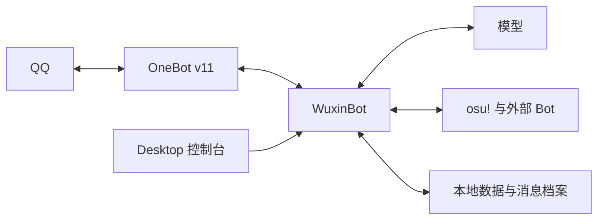

# WuxinBot

WuxinBot 是一个用于 QQ 的聊天机器人，默认人格为 pippi。它支持群聊对话、osu! 数据查询和图片卡片，并提供 Windows Desktop 客户端管理连接、群设置和本地服务。

机器人通过 OneBot v11 收发 QQ 消息。聊天模型可以使用 DeepSeek、OpenAI 兼容 API，或项目支持的 Codex App Server 通道。Kanon、Yumu、Hydrant、LazyBot 是可选的外部 Bot，需要单独部署。

## 功能

### 聊天与图片

pippi 可以结合当前对话、已保存的记忆和关系状态决定是否接话。每个群可以选择自然聊天、仅在被提及时回应、仅 osu! 指令等模式，并分别设置成员权限。社交功能在“接话与好感”页启用，新安装默认关闭；人格和表达偏好可在“人设”页调整。

关系整理和记忆更新在后台进行。被 @ 的请求需要较长处理时，模型可以先发一句简短回应，再继续完成答案。群内随机发图和聊天中选择表情是两个独立功能，可以分别配置。

### osu! 查询

支持账号绑定、玩家资料、BP 与最近成绩、PP+、谱面分析、玩家能力画像和能力对比，也可以监听多人房间并推送比赛事件。玩家与成绩查询使用 osu! API；PP+、Skill Profiler 和外部 Bot 卡片需要配置对应服务。

明确的快捷指令由程序处理。自然语言问题可以由模型选择已注册的工具，再根据查询结果回答。工具执行时仍会检查权限和群设置。

### 功能与消息查询

可以直接问 pippi 有哪些功能，也可以引用她发过的消息，问它来自哪个模块、为什么发送、由谁触发、回应谁、发到了哪里。她会按需调用查询工具，读取当前权限和开关下的功能目录，或实际保存的发送记录。

目录来自已注册的指令、工具和公共功能。消息档案还记录外部 Bot 的实际执行结果、失败后的替代实现、引用、@ 和发送回执。模型自行决定何时查询，完整目录和最近自发消息不会在每轮对话中自动加载。

## 使用示例

在已启用的群里，可以这样使用：

| 输入 | 用途 |
| --- | --- |
| `@pippi 你现在能做什么？` | 查询当前会话可用的功能 |
| 引用她的图片，问“这张图为什么发，是回复谁的？” | 查询这条消息的来源和发送原因 |
| `/w help` | 查看当前身份可见的指令 |
| `/w osu bind <你的用户名>` | 绑定自己的 osu! 账号 |
| `/w info peppy` | 查询玩家资料和 Skill Profiler 能力画像 |
| `/w update peppy` | 刷新玩家资料、能力画像和 PP+ |
| `!info peppy` | 调用 Kanon 玩家卡片，需要启用对应集成 |

这里的 `@pippi` 指 QQ 中实际选择机器人账号进行 @。完整语法与权限以 `/w help` 为准，具体功能还取决于模型、API 和本地组件配置。

具有管理权限的用户可以用 `/w mode osu` 将群设为仅 osu! 指令模式。该模式下，普通消息不进入模型、聊天上下文或画像更新；随机图片仍由它自己的群开关控制。

## 开始使用

### 准备组件

- Windows：Desktop 客户端和仓库中的开发启动命令面向 Windows。
- Node.js 22.14 或更新版本：源码运行和开发需要 Node；发送档案使用内置的 `node:sqlite`。
- OneBot v11 客户端：例如 [NapCatQQ](https://github.com/NapNeko/NapCatQQ)，用于登录机器人 QQ 并提供 HTTP 和 WebSocket 接口。
- 模型连接：为 AI 对话配置所用供应商、模型名称、API 地址和密钥。Codex 通道见[接入说明](docs/CODEX_CHATGPT_PROVIDER.md)。

使用 osu! 查询时，还需配置 osu! OAuth 客户端凭据。外部 Bot、图片渲染器、PP+ 和 Skill Profiler 的部署方式见[集成指南](docs/EXTERNAL_INTEGRATION.md)。

### 使用 Desktop

已有安装包时，安装并打开 WuxinBot Desktop，然后完成以下配置：

1. 在“运行控制”中核对组件路径，只启用已经安装、准备使用的组件，启动 WuxinBot 服务。NapCat 可以由 Desktop 启动，也可以使用已经运行的实例。
2. 在“模型”页填写模型连接信息，在“集成”页填写 Bot QQ、Owner QQ（机器人所有者）、OneBot 地址和相应访问令牌。本机默认 HTTP 地址为 `http://127.0.0.1:3000`，WebSocket 地址为 `ws://127.0.0.1:3001`。
3. 在“群聊”页启用需要使用的群，选择回复模式并设置权限。
4. 确认 QQ 已连接，在测试群发送 `/w help`，再 @ 机器人测试对话。

Desktop 可以单独启停组件、查看就绪状态和日志，也可以配置登录自启及关闭窗口时的处理方式。路径和进程管理细节见 [Desktop 文档](docs/DESKTOP_CLIENT.md)。

### 从源码运行 Desktop

在 PowerShell 中执行：

```powershell
git clone https://github.com/GH-Wuxin/WuxinBot.git
cd WuxinBot
npm ci
Copy-Item .env.example .env
```

编辑 `.env` 填写配置，或启动服务后在控制台设置。常用配置项如下：

| 配置项 | 用途 |
| --- | --- |
| `LLM_PROVIDER`、`LLM_API_BASE_URL`、`LLM_MODEL`、`LLM_API_KEY` | 模型供应商、地址、名称与密钥 |
| `ADMIN_PASSWORD` | 首次创建数据目录时设置管理接口密码 |
| `DATA_DIR` | 业务数据目录 |
| `OSU_CLIENT_ID`、`OSU_CLIENT_SECRET` | osu! API 凭据，使用对应功能时填写 |

其余配置见 [`.env.example`](.env.example)。然后构建界面并打开 Desktop：

```powershell
npm run build
npm run desktop
```

打开客户端后，按上一节完成组件启动与连接配置。`npm run desktop:build` 可以生成 Windows 安装包，输出位于 `release/`。

## 数据与隐私

Windows 默认业务数据目录为 `%APPDATA%\Wuxin`，可通过 `DATA_DIR` 指定其他目录；安装版也支持部署路径配置。`db.json` 保存核心设置，消息、记忆、画像等数据分别保存在其他 JSON 文件中。Desktop 自身的启动配置另存于它的用户数据目录，详见 [Desktop 数据目录说明](docs/DESKTOP_CLIENT.md#迁移后的固定数据目录)。

配置、聊天和记忆保存在本机。使用远程模型时，本轮需要的对话上下文会发送到配置的模型服务；osu! 查询和外部集成也会访问各自的接口。密钥、QQ 登录资料、聊天数据和备份不应提交到仓库。

功能和发送记录查询按当前身份、账号与会话过滤，群聊无法通过这些工具读取其他群或私聊的内容。过去没有记录的详细来源和发送原因会保留为未知。

自发消息档案保存在 `own-messages.sqlite`，独立于普通聊天窗口；聊天历史超过窗口容量后，仍可分页查询已保存的发送记录。清空会话会同时清理对应的可查询档案。

数据库备份包含合并后的 JSON 和元数据；已有发送档案时，还会生成同名的 `.own-messages.sqlite` 快照。复制备份时应保留这一组文件。图片池、QQ 登录资料和外部组件数据库需要另行备份。

## 开发



`server/` 包含消息处理、工具调用和数据存储，`src/` 是控制台界面，`desktop/` 管理桌面窗口和本地进程。模型只能使用程序开放的工具，调用次数、超时、权限和发送结果由程序检查。

安装依赖后，常用命令如下：

```powershell
npm run desktop:dev             # 开发界面和 Desktop
npm run server                  # 单独运行后端，修改代码后自动重启
npm start                       # 单独运行后端
npm run typecheck               # TypeScript 检查
npm run check                   # 类型、构建与主要回归检查
npm run pippi:awareness:verify   # 功能查询、发送记录与回复流程检查
```

`npm start` 和 `npm run server` 用于单独调试后端，Desktop 的“运行控制”也能启动后端；同一个数据目录只运行一个实例。测试使用独立临时数据目录，保留生产路径保护。隔离检查如果报告生产数据仍在变化，应停下对应的生产写入进程再验证。

本地聊天语料的导入与审阅工具见 [community-corpus](community-corpus/README.md)，外部组件补丁见 [patches](patches/README.md)。

## 详细文档

- [Desktop 使用与进程管理](docs/DESKTOP_CLIENT.md)
- [OneBot、模型、osu! 与外部 Bot 集成](docs/EXTERNAL_INTEGRATION.md)
- [人格、关系与经历](docs/PIPPI_PERSONALITY.md)
- [常驻感知](docs/PRESENCE_MODE.md)
- [节能模式](docs/TOKEN_SAVING.md)
- [功能查询、消息归属与回复流程](docs/pippi-awareness.md)
- [osu! 官方资料搜索](docs/OSU_SEARCH.md)
- [知识库配置](docs/KNOWLEDGE_BASE_V41.md)

## 许可证

WuxinBot 主体代码采用 [MIT License](LICENSE)。

`server/osu/matchRating.ts` 和 `server/osu/match.ts` 包含派生自 [yumu-bot](https://github.com/yumu-bot/yumu-bot) 的 Apache-2.0 代码。来源与修改说明见 [THIRD_PARTY_NOTICES.md](THIRD_PARTY_NOTICES.md)，许可证全文见 [LICENSE.yumu-bot](LICENSE.yumu-bot)。
