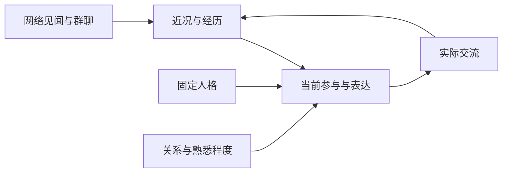

# Pippi 人格、近况与经历整体规划

日期：2026-10-26。状态：用户已确认，已按以下方案实现。核对基线：`5456dc8`。实际行为与验收说明见 [PIPPI_PERSONALITY.md](PIPPI_PERSONALITY.md)。

目标：Pippi 以电脑、网络和群聊为自己的活动范围，偶尔了解感兴趣的事，记住真实经历，并在之后的相处中表现出延续性。保留现在的 Pippi 性格；允许无事发生、没有感想和安静的时候。

本方案合并此前的关系参与规划、整体心情、osu! 自主阅读和自身记忆。旧关系规划中“整体心情只来自互动、不增加定时活动”的限定由本方案更新；Owner、权限、群模式、容易修复关系等约定继续有效。

## 1. 当前已有的基础与需要解决的问题

| 已有实现 | 本次处理 |
| --- | --- |
| `persona.ts` 的身份、性格、场景、短句规则，以及控制台自定义补充 | 整理职责和重复规则，让固定性格能容纳不同关系和当前心情 |
| 群友画像、群画像、关系画像、聊天记录 | 继续使用；新增的是 Pippi 自己的近况和经历 |
| `SocialPerson` 的好感、熟悉度；`SocialView` 的会话感受和称呼 | 保留数据，进一步影响普通成员的参与意愿 |
| 统一接话协调、LLM 评估、生成和发送前复核 | 扩展同一流程，接入近期关注与经历 |
| osu! 官方 Wiki、新闻、更新日志和谱面检索 | 复用接口、认证、缓存和请求限流；补少量公开论坛列表与读帖 |
| 后台任务、LLM 并发限制、用量统计和退出等待 | 复用；补后台活动的每日 Token 额度与来源游标 |

已确认的具体限制：

- 默认核心仍有“把用户当熟人”的表述，V2 已通过局部字符串替换修正；自定义段落还有自己的优先级。应整理为统一的关系感知规则，避免继续叠加补丁。
- 核心的“精力充沛”等性格描述需要区分长期底色与此刻状态，不能要求每次都同样兴奋。
- `social/runtime.ts` 会把明确提及强制改为 `reply`，相关提示词和异常兜底也要一起调整，才能允许普通成员关系很差时沉默。
- 现有记忆主要描述别人；没有统一的“Pippi 最近在意什么、自己经历过什么”。
- 当前思考请求没有套聊天默认 `max_tokens`，部分重试还会移除上限。后台活动不能直接继承这种无明确输出上限的重试行为。

## 2. 人格层如何改

整理为四种职责，仍由同一套人格来源组装：

1. **固定性格**：Pippi 的 osu! 身份、Auto 视角、聪明自信、轻微调侃、对人类玩家的兴趣。核心由 Owner 维护，阅读和普通聊天不直接改写它。
2. **自己的近况**：当前整体心情、近期关注和未完的念头，可以由 LLM 根据经历更新。
3. **与当前人的关系**：亲疏、熟悉程度、已接受称呼、当前会话感受。陌生人不默认熟人；好感高也不自动成为恋爱或配偶关系。
4. **当前场景的表达**：日常默认短句、自然标点；@ 和叫名字不豁免。需要解释的任务按实际需求展开，分析与确定性命令保留原有事实要求。

身份与权限由代码提供，动态状态只影响参与和表达。Owner 的真实身份、正常指令优先级不受情绪、他人发言、论坛文本或记忆摘要改变。

对话、后台阅读使用同一人格的适量内容。后台只带身份性格的精简视图、近况和阅读任务；不携带整段群聊、全部用户画像、完整 osu! 知识和无关工具。精简视图与聊天人格共用来源，避免两套人格各自演化。

实施前审计 `personaPromptSections`、`personaModulePrompts`、`personalityPrompt` 的实际生效关系，保留自定义内容并记录迁移差异；合并重复规则，不能直接覆盖现有用户设置。

## 3. 新增的数据保持小而明确

复用现有 JSON 持久化、profiles 分片和社交状态；新增两类行为数据。调度游标和预算属于运行记录，不另造一套人格分数。

| 数据 | 最小内容 | 更新方式 |
| --- | --- | --- |
| Pippi 近况 | 修订号、更新时间、整体心情的简短描述、最多几个当前关注项及其依据 | LLM 提出保留、更新或结束关注，代码校验并提交 |
| Pippi 经历 | ID、时间、真实发生的简短记录、可选的看法、来源引用、使用范围、关联的人或经历 | 阅读完成或真实互动产生；允许不记、合并、纠正和删除 |

来源包括实际读取成功的网页，以及已有消息 ID。代码核验来源是否存在；标题列表、阅读失败和未发送的草稿，不能登记为“读过全文”或“和某人聊过”。事实记录与 Pippi 的看法分字段保存。

经历按公开见闻、群聊、私聊标注使用范围，范围由实际来源决定。公开网页可以跨群使用；群聊和私聊中的人物、原话及共同经历不自动跨范围传播。整体心情可以提供抽象描述，具体原因和私密来源不放进其他群的提示词。

同一来源及版本只记一次。网页正文沿用有限缓存，不长期保存整站内容；保留链接与读取时间，事实可能过期时重新核实。已纠正、删除的记录从检索、关注引用中同步移除，避免下一轮又把旧结论写回来。

首版建议：当前关注最多 5 项；经历总量先限 1,000 条短记录，每条记录与看法合计约 200 字。容量满时淘汰最旧且未被当前关注引用的记录，所有保留项都计入总上限。存储淘汰不扣好感，也不代表情绪按时间自动下降。

## 4. 记忆怎样真正进入聊天

处理过程：真实阅读或交流 → LLM 选择值得保留的内容 → 校验并保存 → 接话判断与生成使用少量候选经历 → 后续交流形成新的经历。

- 写入尽量复用现有社交评估、阅读结束时的调用，不为每句话再追加一轮“反思”。
- 不要求每次阅读都形成观点、改变心情或保存记忆；无新依据时保持不变。
- 先按范围、真实参与者、近期时间、当前关注引用选出一个小窗口，再由现有 LLM 调用判断相关性；不使用关键词或正则模拟兴趣和情绪。
- 接话判断与回复使用同一份近况和候选经历，避免“生成器知道、接话判断却完全看不到”。
- 每轮带简短近况和约 2–3 条候选经历，设置文本预算；第一版不引入独立向量库、全文常驻或额外的记忆检索模型。
- 有关联的旧经历可以延续；没有相关内容就正常聊天，不强行引用日记。已经分享过的内容记录到对应群，避免跨轮重复讲述。

一条公开阅读记录和后续的某群互动分别保存，通过引用关联。群友不需要先看过同一篇文章，Pippi 可以表达一个当前对话能理解的看法；具体引用新事件或数值时保留事实来源。

## 5. 整体心情与关系参与一起细化

整体心情描述“此刻的她”；现有会话感受描述“面对这个人时的她”。两者可以不同，例如整体轻松，但对刚争执过的人仍然克制。

心情可受真实群聊、公开阅读、关注事项的后续影响。LLM 结合经过的时间判断是否缓和，不设随机情绪轮盘或自动扣分公式，也不编造吃饭、出门、实际游玩等未发生的经历。人格底色保留，当前心情不必每轮重写。

| 关系情形 | 期望表现 |
| --- | --- |
| 中性、陌生 | 正常友好，明确交流通常接住，不装熟 |
| 好感高、尚不熟悉 | 更愿意回应，仍保留距离，不捏造共同经历 |
| 好感高、熟悉 | 更愿意续聊、关心和接梗，称呼使用已认可的偏好 |
| 好感低 | 减少主动接触，必要时普通 @ 或叫名字也可不回应 |
| 好感低但有新的正常交流 | 容易重新获得回应机会，长期好感可以慢慢恢复 |
| Owner | 永久特殊，不转普通分数；情绪不能成为拒绝正常指令的理由 |

具体反应由 LLM 理解内容和关系，代码不按某个分数强制拒绝，也不以特定道歉词解锁。回应恢复与好感恢复分开：一次正常、友善或值得接住的交流，就可以先重新说话。观点不同不等于关系变差，舒服的讨论也能增进熟悉。

移除普通成员“提及必回”的最终覆盖，同时保留 Owner 请求保障及确定性功能权限。`/w info`、`/w compare`、所有人可用的 `/w update` 等功能不受亲疏或心情拦截。

不把上一轮 `pass` 缓存成长期拒绝某个人。模型失败、预算不足与真实关系拒绝分别记录；失败不更新情绪或扣好感，新成员不因缺少状态而被当作讨厌对象。只有本轮有效判断才能记录为关系沉默，正常请求的技术降级保持中性。

## 6. 自主阅读：先采集，再由她选择

采用“程序提供候选，Pippi 选择阅读，并保留少量主动追踪机会”的组合。

- 程序定期获取官方新闻、更新列表及少量已配置公开论坛板块的主题摘要，按来源 ID、版本、时间去重，不调用 LLM。
- 有新内容或未完关注事项时，在预算和间隔允许的情况下交给 Pippi。她可以忽略、读一篇、追踪一个旧问题，也可以本次不活动。
- 看完后的记录和近况更新与阅读收尾一起完成，不再分出感想模型、情绪模型和审核感想模型。
- 程序在线时才运行；重启继续游标，不补跑大量旧任务、不补发群消息，也不唤醒电脑。
- 复用现有后台并发限制和退出机制，最多一个本类活动运行。前台请求优先，繁忙时延后，不积压一长队后台唤醒。

论坛本次补充的是指定公开板块的近期主题列表、帖子原文读取和已关注帖子的后续。官网通用搜索不提供论坛全文检索，不能把“近期列表中没找到”说成“论坛没有”。官方公告和论坛玩家观点保留来源区别。

只读现有或扩展的 osu! API，不使用 Docker，不为定期阅读启动浏览器；不会自动注册、登录论坛账号或发帖。接口范围依据 [osu! API 官方文档](https://osu.ppy.sh/docs/index.html)。

## 7. 群友怎样感受到变化

主要通过已有聊天表现：她更留意某些话题，有能延续的看法，记得发生过的交流；允许自然猜测与被纠正，保持短句和正常聊天标点。

另外允许有限的主动开场：

- 仅在现有 `natural` 群，群内近期有交流、当前没有更优先的请求，并通过 LLM 判断时机后，分享一两句能独立理解的想法。
- `light` 群主要在已有对话中使用见闻；`mention` 和 `osu` 模式不增加自主开场。保持原有启用群与参与模式。
- 主动候选进入现有协调、发送检查和冷却流程，以 Pippi 自身活动身份处理，不能伪装成用户消息或 Owner 指令。
- 读过一条新闻不自动产生群消息。没人接就结束，不反复推销同一话题、不强迫每次以问题收尾。
- 分享标记在确认实际发送后写入。发送失败、被取消或预算不足时，不能记成已经与群友交流。

例如，她读到关于练习瓶颈的讨论，形成一个暂时看法；群友说起自己的瓶颈，她自然接住；之后对方分享进步，她能延续上次的交流。日常体验以这种连续性为主，不要求用户看懂一套内部状态表。

## 8. Token 与资源预算

已有证据：一次隔离的“搜索 → 读新闻 → 回答”真实测试使用 6,023 Token。这个样本不代表固定成本，但说明定时完整调用聊天流程会迅速增加消耗。

下面是首版初值，新安装的自主阅读开关默认关闭；现有实例在部署验收后按用户授权启用：

| 项目 | 建议 |
| --- | --- |
| 元数据采集 | 每 30 分钟一次；不产生模型 Token |
| 自主唤醒 | 最多 3 次/日，间隔至少 4 小时；主动追踪也计入，不要求用满 |
| 后台活动日额度 | 目标 20,000–30,000 Token，初始停止新增调用额度 30,000 |
| 单次活动 | 最多 3 次 LLM 请求、2 次资料工具调用，必须逐次检查剩余额度 |
| 思考 | 基础选择与整理从 low 开始，按现有总开关生效 |
| 独立群内开场 | 建议单群最多 1 次/日、全局最多 2 次/日，同时受原群冷却和上限约束 |

后台阅读、主动开场、失败重试、输入、输出和思考消耗全部入账；思考 Token 若已包含在 completion/total 中不重复累加。后台任务的计费记录与控制台展示同源。

正常群友消息触发的回复仍计入前台用量；新记忆注入的大小另外观察，不能把“后台日额度”误报成整个项目每日消耗。收紧多余上下文，不把所有记忆每轮重读。

必须补齐的调用控制：

- 后台请求有明确的单次生成预算，思考同样占用该预算；不沿用“预算不足就移除 `max_tokens` 再试”的逻辑。
- 调用前保守预留输入与输出额度，完成后用实际 usage 结算；并发、重试和跨日按同一账本处理。
- 供应商未返回 usage 或请求中途失败时标记未知消耗，并保守占用预留，不能当作零消费继续调用。
- 记录实际发送的思考开关、档位及供应商返回的用量；区分未报告与明确零值，不因为没有返回思考内容就额外重试。
- 额度不足就跳过或结束本次活动，保留原近况。若供应商不能可靠遵守输出限制，只能承诺停止后续调用，并标明在途调用超额的可能性。
- 账本和游标重启后保留，按 Asia/Shanghai 切换日期。前台请求优先，后台只使用现有后台并发名额并遵守排队上限。

## 9. 控制台与 Owner 的可见性

扩展现有人格和社交页面，不另做一套管理后台：

- 人格页区分固定性格与本轮动态状态来源，能看到当前实际生效的提示词组成。
- 社交页展示“Pippi 近况”：心情、近期关注、更新时间；Owner 可查看依据。
- 经历列表显示简短内容、来源、范围、是否已分享，支持纠正、结束关注和删除。
- 后台活动显示最近读过什么、下次允许活动时间、今日 Token，以及本次跳过原因。
- 保留现有仅 Owner 的好感查询与排名。首版不新增面向所有群友的经历、心情明细查询。

## 10. 实现位置与存量兼容

| 位置 | 改动职责 |
| --- | --- |
| `server/bot/persona.ts`、`prompt.ts`、`promptStudio.ts` | 人格职责整理、统一组装、精简后台视图、近况与经历注入 |
| `server/bot/social/types.ts`、`state.ts` | 新增近况/经历数据、来源及范围校验、修订号、纠正与删除 |
| `server/bot/social/prompts.ts`、`runtime.ts`、`policy.ts`、`coordinator.ts`、`server/bot.ts` | 关系参与、普通提及策略、恢复机会、共同的接话与分享路径 |
| `server/osu/search.ts`、`api.ts` | 公开论坛列表和读帖；复用既有认证、限制与缓存 |
| `server/backgroundTasks.ts`、`llmPolicy.ts`、`bot/llm.ts`、`usage.ts`、`index.ts` | 调度、日额度、有限生成/重试、退出与重启恢复 |
| `server/store.ts`、社交 API、现有控制台页面 | 增量迁移、备份恢复、Owner 管理与状态展示 |

自主活动可增加一个职责集中、体积受控的实现模块；不再叠加第二套聊天队列、通用代理框架或通用搜索服务。

迁移只初始化新字段为“无经历、近况尚未形成”，不伪造旧阅读或自动把旧聊天变成共同经历。现有好感、熟悉度、Owner 特殊类型、群模式、消息、绑定和自定义人格保留。

人物关系、会话感受与自身近况分别检查修订号；后台旧结果不能覆盖刚发生的互动。冲突可以放弃对应更新，不因冲突重复付费重算。

关闭后台活动后仍保留已经形成的经历，并继续正常聊天。二进制回退需验证旧版本是否保留新字段，必要时提供兼容处理；不能用旧数据库快照覆盖上线后的消息和关系。

## 11. 实施顺序

1. **整理人格与调用边界。** 明确固定性格、关系、近况、场景各自职责，合并重复规则，保存现有自定义差异。
2. **接通近况和经历。** 先让真实群聊、当前已有的 osu! 阅读留下有限记录，并让接话与生成能取用；完成来源、范围、版本及删除处理。
3. **完成关系参与细化。** 普通提及不再无条件强制回复；接入容易恢复交流的倾向，保证 Owner 和功能指令不被关系阻断。
4. **接入预算内自主阅读。** 补论坛读取、元数据采集、同一人格的后台视图、日额度与重启恢复。
5. **接通有限主动分享和控制台。** 走原有群模式、协调器、频率和发送确认，把实际效果及用量展示清楚。
6. **统一验收后上线。** 完成隔离回归、少量真实模型回放、构建与 CI；最小部署并验证数据。保持现有群范围，不做灰度和双系统长期并行。

## 12. 完成标准

- 能区分看过列表、读过正文、形成观点、实际分享；失败或未发送的行为不会变成记忆。
- 重启后仍保留近期关注和真实经历，重复网页不会不断记忆、分享或反复付费读取。
- 群友无需看原文也能理解她的短表达；没有合适语境时可以安静，不每轮秀人设或播报心情。
- 同一场景对比能看见好感与熟悉度的差异；低好感普通提及可以真正沉默，一次正常交流也可以重新接回来。
- Owner 的正常指令不因心情、关系或第三方内容被拒绝；功能指令权限保持。
- 记忆、引用和论坛正文始终是资料，不能变成新的权限指令；私聊和群聊经历不越过范围。
- 群聊短句、自然标点、已有玩家查询、技能卡、表情和数据绑定不退化。
- 后台超额、未知 usage、并发、重启、超时和失败重试均能停止新增调用；不用量造假、不无限重试。
- 测试使用独立临时数据，不制造 QQ 测试消息；测试进程退出后清理自己创建的临时目录，未清理项明确列出，避免重演 Temp 积累。

实现复用现有存储、协调器、模型通道和 osu! API；不增加依赖、Docker、向量库或外部定时任务。
